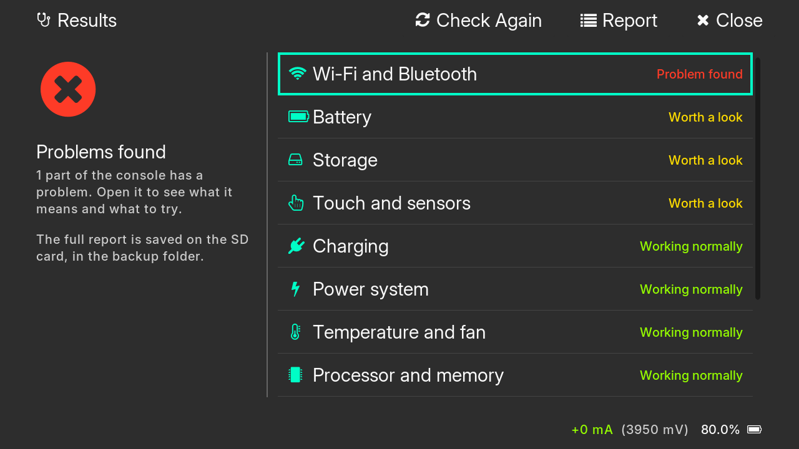
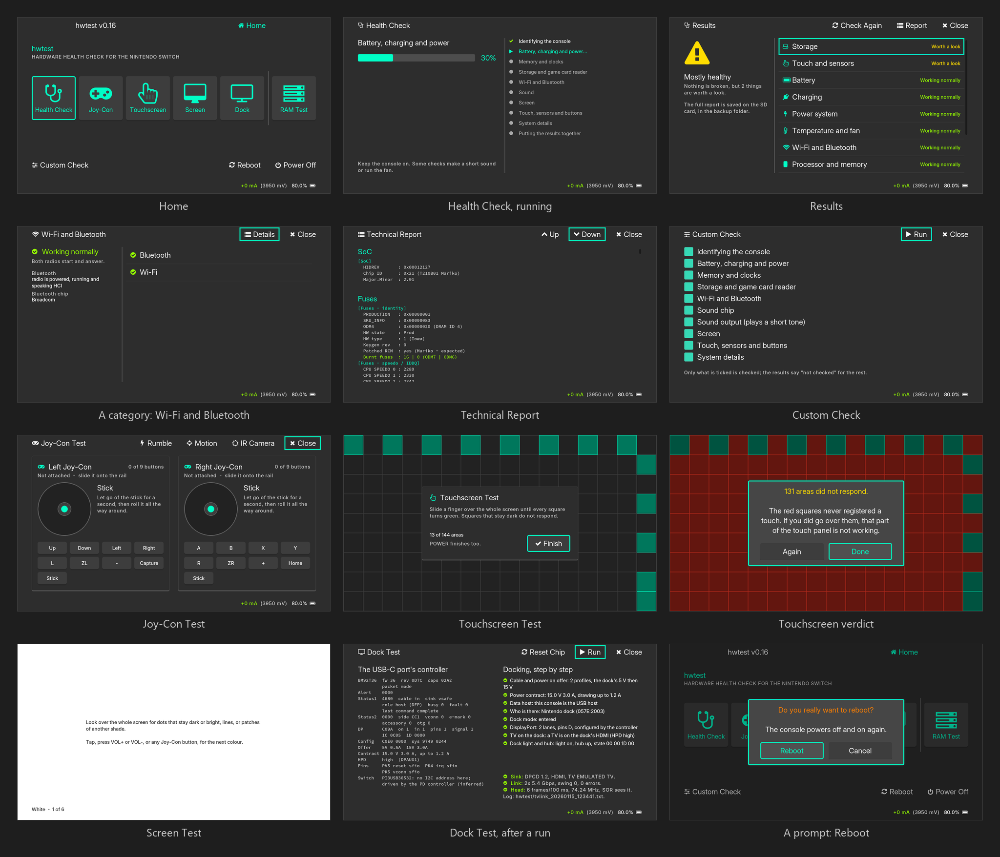

# hwtest RCM



An active RCM (Recovery Mode) hardware diagnostic that probes the Switch from
the BPMP (the Boot and Power Management Processor, the small ARM7 core that
runs before the main CPU comes up), then reports identity / status / faults to
the LCD and the debug console: UART-B on the Joy-Con right rail (115200 8N1),
unless [`hwtest/hwtest.ini`](#the-debug-console-hwtesthwtestini) moves it. The
report can also be written to `backup/<emmc_serial>/hwtest.txt` on the SD
card.

The intended audience is repair techs working on Erista or Mariko consoles
(handheld, V2, OLED, Lite). The output is colour-coded so a unit with a
borderline reading or a real fault stands out without reading every line. For
everyone else there is a [GUI](#gui) that explains the results in plain words.

The payload is not register-read-only. Active probes can change temporary rails,
GPIO/pinmux, clocks, power partitions, PWM, radio reset state, audio fabric,
gamecard state, touch/ALS power, and CPU0 state. Most changes are volatile and
many probes restore the state they own, but teardown is not yet exact for every
subsystem. The touch probe deliberately avoids Hekate's button-triggered
autotune path, runs the FTS ITO production test without saving compensation, and
powers the touch controller down afterward.

## Building

```sh
git submodule update --init --recursive
export DEVKITARM=/opt/devkitpro/devkitARM   # or wherever yours lives
make                                        # build/hwtest.bin, the payload
make ram                                    # build-ram/hwtest_ram.bin, the RAM test
make gui                                    # build-gui/gui.bin and libsys_minerva.bso, for the SD card
make sdzip                                  # all of it as build/hwtest-sd.zip
```

Hekate provides the BDK/SoC support; the RAM build takes its MTC sources and
timing tables from `third_party/Atmosphere` and applies
`ramtest/patches/atmosphere-mtc.patch` in `build-ram/`.

devkitARM builds the BPMP payload; **devkitA64** (or another suitable AArch64
compiler) builds the small stub the Wi-Fi probe runs on CPU0, because BPMP
cannot reach PCIe directly. Without it the build still completes and the Wi-Fi
probe reports `CPU0 handoff : not built`; release builds use `REQUIRE_A64=1`,
so a missing CPU0 stub fails them.

## Dedicated RAM diagnostic

`build-ram/hwtest_ram.bin` is for suspected DRAM / memory-bus faults. It tests
almost all free DRAM, including RAM above 4 GiB, on Erista and Mariko alike.

It opens a physical-key menu: **Quick test**, **Advanced test**, **Custom
test**, and **Power off**. VOL+ moves down, VOL- moves up, and POWER selects or
toggles. **VOL-** aborts a running test after the current 4 MiB region; after
an abort or completed run, POWER returns to the RAM-test menu and VOL- powers
off.

| Mode | Coverage |
|---|---|
| Quick | 1600 MHz training, walking data-bit preflight, one full Address-pattern write sweep, then a separate full verify sweep |
| Advanced | Training/preflight plus all seven patterns: Address, Inverse address, all-zero, all-one, `AA`, `55`, and address-seeded PRBS with retention |
| Custom | Training/preflight plus any non-empty user-selected subset of the seven patterns |

Writes and verification are separate full-memory phases on purpose: an
address-decoder alias can otherwise pass an immediate write/read-back test.

## Running

Inject `build/hwtest.bin` like any other RCM payload (fusee-launcher,
TegraRcmGUI, a modchip). Without the [GUI](#gui) on the SD card, it opens
a physical-key launcher before storage, touch, thermal, or other diagnostic
subsystems are initialized:

| Launcher entry | Action |
|---|---|
| **Hardware test** | Run the complete hardware diagnostic sweep |
| **RAM test** | Load `hwtest_ram.bin` from SD and enter the dedicated RAM-test menu |
| **Custom test** | Choose which hardware diagnostic groups should run |
| **Power off** | Request a clean PMIC power-off without running diagnostics |

VOL+ moves down, VOL- moves up (VOL+ always goes forward, here and in the
pager), and POWER selects. For RAM test the launcher searches
`bootloader/payloads/hwtest_ram.bin`, `hwtest_ram.bin`, then `/hwtest_ram.bin`.
If RAM payload loading fails, control returns to the launcher.

After Hardware test or Custom test completes, the LCD pager opens on the
verdict. If SD is unavailable, the diagnostic still runs; only the report file
is skipped. A Custom test without Storage / gamecard does not bring the SD card
up, so it writes no report and `s` answers SD not ready.

| Pager/UART key | Action |
|---|---|
| `n` / space / VOL+ | Next page |
| `p` / `b` / VOL- | Previous page |
| `r` | Refresh current LCD page |
| `a` / `A` | Refresh ALL probes (re-emit full UART dump) |
| `G<name>\n` | Refresh just the named group (host viewer uses this) |
| `w` / `W` | Re-run the [Wi-Fi PCIe probe](docs/wireless.md#wi-fi-radio-probe-pcie) (it already runs in the sweep) |
| `s` / `S` | Re-write the SD report file |
| `R` | Reboot (PMIC power cycle, so a modchip re-injects) |
| `q` / POWER | Power off the console |

## GUI



For people who are not technicians, `hwtest.bin` has a second face: a
touch and Joy-Con interface that looks like hekate's Nyx, runs the same checks,
and explains the results in plain words. It is too large to be injected, so it
lives on the SD card and `hwtest.bin` hands over to it, the way hekate hands
over to Nyx:

```
SD card
|-- bootloader/payloads/
|   |-- hwtest.bin           build/hwtest.bin (also for hekate's Payloads menu)
|   `-- hwtest_ram.bin       build-ram/hwtest_ram.bin (only for the RAM test)
`-- hwtest/
    |-- gui.bin              build-gui/gui.bin
    |-- libsys_minerva.bso   build-gui/libsys_minerva.bso (optional, faster drawing)
    `-- hwtest.ini           the debug console's port (optional, see below)
```

`make sdzip` packs exactly that, to be unzipped at the root of the card; every
release carries it as `hwtest-sd.zip`.

Without `hwtest/gui.bin` (no card, an unreadable card, or a file that is not a
hwtest GUI image), the text launcher above runs instead, so a console whose SD
slot is the fault can still be diagnosed. Hold **VOL-** while the payload
starts to skip the GUI on purpose.

Every screen works with any one of:

| Input | Move | Select | Back |
|---|---|---|---|
| Touchscreen | - | tap | Close |
| Joy-Con | stick or D-pad | A | B |
| Console buttons | VOL+ / VOL- | POWER | Close |

The console buttons are enough on their own, for a console with a broken
touchscreen and no Joy-Con. On the Joy-Con, Motion and IR Camera tests the
Joy-Con is what is being tested, so it does not navigate there: leave them with
POWER or a tap. On the Screen test a Joy-Con button turns the page, but the
closing box needs a tap or POWER.

| Screen | What it does |
|---|---|
| **Home** | Health Check, Joy-Con, Touchscreen, Screen, Dock and RAM Test, and along the bottom Custom Check, Last Results, and Reboot / Power Off (each asks first). |
| **Health Check** | The full sweep, with the steps ticked off. Then one row per part of the console saying in a few words whether it is fine; each opens to what was checked, what a problem means and what to try, and from there to the report pages behind it. The report is saved to the SD card. |
| **Custom Check** | One checkbox per group of checks, then Run; what was not picked shows as "not checked". UART output moves the debug console for the session: UART-B on the right rail, UART-C on the left rail (not on a Lite), UART-A on the board's test pads (cluster C: pad 3 TX, pad 2 RX), all 115200 8N1 at 1.8 V, or USB serial over the USB-C port, which Windows 10 and later, Linux and macOS use without a driver (USB ID 1209:0001) and which is open beside any of them anyway. |
| **Joy-Con** | Both Joy-Cons (or a Lite's built-in controls): every button reachable on the rail (not SL/SR) lights up when pressed and stays marked, and each stick is drawn live and judged against the Joy-Con's own calibration, read from its flash (or against its own travel when it has none). A connection that drops and comes back is counted, which is what a worn rail looks like. |
| **Rumble** | The left Joy-Con buzzes for half a second, then the right. One that stays still has a dead motor or driver. |
| **Motion** | The Joy-Cons' accelerometer and gyroscope, live. A sensor that reads about 1 g and no rotation while the Joy-Con is held still passes; one that sends zeros or nothing fails. |
| **IR Camera** | The right Joy-Con's infrared camera, live, in four sizes from 40 x 30 up to its full 320 x 240. A start-up step that fails is named with what the Joy-Con answered. |
| **Bluetooth** | From the Joy-Con screen, on a Lite too: finds a Joy-Con or a Pro Controller in pairing mode, connects to it over the console's own radio and shows every button, SL and SR included, and its sticks. Pair from rails puts the Joy-Cons on the rails in pairing mode, no sync button needed. See [docs/bluetooth.md](docs/bluetooth.md). |
| **Touchscreen** | A grid over the whole panel that turns green under a finger; what never turns green does not respond. |
| **Screen** | The whole panel in one colour at a time, then white while the backlight dims and brightens: dead pixels, lines, patches and an uneven or flickering backlight show against a flat field. |
| **Dock Test** | The USB-C port's PD controller (BM92T36) watched live, then the handshake the console performs when it docks, step by step, and with a TV on the dock, this screen on the TV at 1280x720. Reset Chip restarts a controller that does not answer. Nothing of it runs from the health check; see [docs/dock.md](docs/dock.md). |
| **Screenshot** | Two fingers on the panel save the screen as a BMP under `hwtest/screenshots/` on the SD card. |
| **RAM Test** | Starts `hwtest_ram.bin` from the card, as the text launcher's RAM test does. |

The status bar shows the console's serial number when `sd:/switch/prod.keys`
(from Lockpick_RCM) is on the card, and says in yellow when it is missing or
unusable; the battery is on the right, as Nyx shows it.

The GUI's debug console starts on the port `hwtest/hwtest.ini` picks, UART-B
when it does not say, with the `R` reboot, and Custom Check can move it. A
rail's port stops being the console once a Joy-Con is attached there. `R` is also taken on UART-B while no Joy-Con has it, whichever
port is picked. The USB serial port carries everything as well, from the
GUI's start (it keeps the last 16 KiB until a PC opens it), and takes the
commands that [push a build](#pushing-a-build-over-usb-host_toolshwtest_pushpy)
over it.

## What's reported

Eleven logical pages (some span multiple LCD-sized sub-pages). The Verdict
page comes first, so the pager opens on the summary. The terms are explained
in [docs/terms.md](docs/terms.md).

| Page | Probes |
|---|---|
| Verdict | rolled-up pass/warn/fail per subsystem, plus three cross-checks: VBUS and ACOK against USB-PD, the charge state against the gauge's current, eMMC HS400 against the bus width |
| SoC | HIDREV chip ID + major/minor |
| Fuses | identity + speedo / IDDQ + lot/wafer + public key + SBK/DK + KFUSE |
| Power & charging | MAX77620 + MAX77621 / MAX77812 + GPIOs + regulators + 5V + battery + charger + USB-PD + thermal + fan |
| Memory & clocks | LPDDR4 / LPDDR4X mode regs + CLK_RST raw + decoded rates |
| Storage | SD + eMMC + partitions + health + GPT + BOOT0/pkg1 + AutoRCM + SD content scan + game card reader, plus PRODINFO: serial, CAL0 body SHA-256, config ID, product model vs SoC, LCD vendor vs fitted panel, WLAN/BD MACs, battery lot, USB-C PD rev, touch IC, IMU, sticks, region, speaker calibration |
| Wireless | Bluetooth: full CYW4356 power-up, then HCI over UART-D. Wi-Fi: a complete T210 PCIe bring-up on CPU0, link training and endpoint enumeration (`14E4:43EC`); a dead CPU rail is reported on the Verdict's **CPU complex** row rather than hanging the console. See [docs/wireless.md](docs/wireless.md) |
| Audio | ALC5639 codec identity over I2C-1 + an I2C-1 census + APE/AHUB power and clocks + AUD_MCLK, then a melody on the left speaker, the right speaker, then the headphone jack, one output at a time. See [docs/audio.md](docs/audio.md) |
| Display | DSI panel ID + backlight PWM + GPIO state |
| Inputs | FTS touch FW + electrical ITO open/short test + ALS + Joy-Con rails + buttons + AC adapter |
| Raw state | GPIO pin census + UART debug port + reset reason + PMC scratch |

## The debug console (`hwtest/hwtest.ini`)

The debug console is UART-B on the Joy-Con right rail. A console whose right
rail is damaged, or whose USB-C port does not work, can have it elsewhere
with `hwtest/hwtest.ini` on the SD card:

```ini
# uart-b: the right Joy-Con rail (the default, also without this file)
# uart-c: the left Joy-Con rail (not on a Lite)
# uart-a: the board's test pads (cluster C: pad 3 TX, pad 2 RX)
console=uart-b
# THE GUI ONLY: 1 also sends its console over the USB-C port (the default), 0 leaves USB off
gui_usb=1
# THE DOCK TEST ONLY, bench tests of the DisplayPort lanes (both default 0):
# dp_pol=1 drives both lanes with inverted polarity, dp_swap=1 exchanges lanes 0 and 1.
# For a console that trains Realtek docks (OLED, clones) but not a Nintendo dock's
# STDP2550: if a Nintendo dock trains with dp_pol=1, the console's DP pairs are swapped.
dp_pol=0
dp_swap=0
```

All three UARTs run at 115200 8N1 with 1.8 V levels. Both stages read
`console`: hwtest.bin when its text launcher takes over (it says
`[boot] console moves to UART-A` on UART-B first), the GUI when it starts.
`gui_usb` is the GUI's alone: hwtest.bin has no USB, so the USB serial port
exists only once the GUI runs. Without a readable SD card nothing can be
read, and the console stays on UART-B. `R` still reboots from UART-B
whichever port is picked, as long as no Joy-Con has the right rail.
`hwtest_push.py console uart-a` writes the file over USB.

## Host viewer (`host_tools/hwtest_viewer.py`)

ImGui front-end that connects to the same UART and understands both payloads:
the hardware payload's pages (on a frozen console, the Runtime page's **Last
step** says where it stopped) and the RAM test's progress and failing words.
For the hardware payload, the toolbar can refresh a group or all probes, save
the SD report or power off.

```sh
pip install -r host_tools/requirements.txt
python host_tools/hwtest_viewer.py --port /dev/ttyUSB0
# or replay a saved capture (no console needed):
python host_tools/hwtest_viewer.py --replay path/to/uart_capture.txt
```

The Switch UART runs at 1.8 V. Use a level-shifter between the Tegra rail
and any USB-TTL cable that doesn't natively support 1.8 V. For wiring the
Joy-Con right rail as a UART tap, see this gbatemp guide:
<https://gbatemp.net/threads/how-to-make-a-joycon-rail-uart-to-capture-boot-log.625784/>.
Without an adapter on the rail, the Raw state page reads its RX line LOW; that
is not a fault.

## Pushing a build over USB (`host_tools/hwtest_push.py`)

With the GUI running and the console's USB-C port on a PC, a new build goes
onto the SD card and starts without touching the console:

```sh
python host_tools/hwtest_push.py release      # the four built files, run, then the new build's log
python host_tools/hwtest_push.py log          # the debug console, live; reconnects across restarts
python host_tools/hwtest_push.py ping         # which build is running
python host_tools/hwtest_push.py cmd BT STATE # any console command, see docs/gui.md
python host_tools/hwtest_push.py console uart-a   # write hwtest/hwtest.ini (--gui-usb 0|1), from the next start
python host_tools/hwtest_push.py report       # copy the last saved report off the card (also: ls, get)
```

The port is found by its USB ID (1209:0001; `--port` overrides). The GUI only
writes the four files a release puts on the card and `hwtest/hwtest.ini`,
each checked by CRC-32,
written beside the old one, read back and only then renamed over it, and then
starts `bootloader/payloads/hwtest.bin` from the card, which brings up the new
GUI. The first GUI with this has to reach the card by hand. The commands are
in [docs/gui.md](docs/gui.md#commands-from-the-pc).

## Technical notes

| Note | Covers |
|---|---|
| [docs/soc.md](docs/soc.md) | SoC revision, fuses and KFUSE: what each field decodes to, Patched RCM, the Identity and Boot integrity rows |
| [docs/power.md](docs/power.md) | The PMICs, regulators, fuel gauge, charger, USB-PD controller, thermal sensor and fan, and the power cross-checks |
| [docs/memory.md](docs/memory.md) | DRAM identity, the channel symmetry check, PLL lock and the decoded clock rates |
| [docs/storage.md](docs/storage.md) | SD and eMMC bring-up, PRODINFO and CAL0, eMMC health, GPT, BOOT0 (pkg1, AutoRCM), error counters, the SD report |
| [docs/gamecard.md](docs/gamecard.md) | The game card reader probe: what it never does, what it reports, what it puts back |
| [docs/wireless.md](docs/wireless.md) | The Bluetooth and Wi-Fi probes: why the PCIe half runs on CPU0, the bring-up sequence, reading its output |
| [docs/audio.md](docs/audio.md) | The audio probe: codec identity, clocks, the melody, and the gotchas behind it |
| [docs/display.md](docs/display.md) | The panel ID and its decoding, the backlight, the CAL0 LCD vendor check |
| [docs/inputs.md](docs/inputs.md) | The touch panel, the ambient light sensor, the Joy-Con rail lines and the input census |
| [docs/raw-state.md](docs/raw-state.md) | The pin census, the UART debug port, reset reason, PMIC latches, RTC and PMC scratch |
| [docs/verdict.md](docs/verdict.md) | How findings become the Verdict: the registry, cross-checks, rows, aggregation and colours |
| [docs/gui.md](docs/gui.md) | The GUI: hand-over from hwtest.bin, input, screens, the health check, Results, Custom Check, the debug console and the PC's commands |
| [docs/joycon.md](docs/joycon.md) | The Joy-Con Test, rumble, motion sensors, the IR camera and the attach glow |
| [docs/bluetooth.md](docs/bluetooth.md) | The Bluetooth test: the host on the console's radio, pairing, what it took on real hardware, pairing mode from the rails |
| [docs/dock.md](docs/dock.md) | The Dock Test's handshake and the TV picture |
| [docs/ramtest.md](docs/ramtest.md) | The dedicated RAM test: starting it, training, menus, reading a failure |
| [docs/internals.md](docs/internals.md) | The self-extracting loader, the GUI's clocks and fonts, BDK's SDRAM parameter scratch |
| [docs/terms.md](docs/terms.md) | The terms and abbreviations used in the report, the README and these notes |

## Layout

```
hwtest.h             - shared header: logging + finding APIs, probe prototypes
core.c               - page table, the sweep, step breadcrumbs, UART reboot hook
main.c               - boot flow, text launcher hand-off, pager + UART command loop
dbgcfg.c/.h          - hwtest/hwtest.ini: the debug console's port, for hwtest.bin and the GUI
log.c                - logging to the LCD, the debug console and the report capture
dx.c                 - diagnostic-finding registry consumed by the verdict
report.c             - SD report writer (backup/<emmc_serial>/hwtest.txt)
verdict.c            - cross-checks + per-subsystem verdict aggregation
probe_soc.c          - SoC identity, fuses, KFUSE
probe_power.c        - PMIC, regulators, battery, charger, USB-PD, thermal, fan
probe_storage.c      - SD, eMMC, partitions, health, GPT, BOOT0/pkg1, PRODINFO
probe_gamecard.c     - game card reader (Lotus3 ASIC on SDMMC2)
probe_bt.c           - Bluetooth radio (CYW4356 HCI over UART-D)
probe_wifi.c         - Wi-Fi radio (CYW4356 WLAN over PCIe)
probe_audio.c        - ALC5639 codec + I2C-1 census + APE/AHUB clocks + AUD_MCLK
probe_audio_beep.c   - melody through I2S1 to each speaker and the headphone jack
probe_display.c      - DSI panel ID + backlight
probe_inputs.c       - touch, ambient light, Joy-Con rails, buttons
probe_memclk.c       - DRAM identity + clock registers
probe_lowlevel.c     - GPIO census, UART debug port, reset reason, PMC scratch
usbpd.c/.h           - USB-C PD controller (BM92T36) and the dock handshake, for the GUI's Dock Test
dpout.c/.h           - DisplayPort out to the dock: DPAUX1, DPCD, EDID, SOR1 link training, second head
cpu_mbox.h           - BPMP <-> CPU0 mailbox, shared by both toolchains
cpu_stub/            - AArch64 stub that does the PCIe half on CPU0
emmcsn.c             - Hekate-style backup/<emmc_serial>/<sub>/<file> path
loader/              - self-extracting stub: build/hwtest.bin is it plus the deflate-packed payload, under the 130392-byte RCM limit
ui_menu.c/.h         - physical-key launcher, custom probe selection, GUI and RAM payload loaders
ui_theme.h           - shared LCD colors and menu geometry used by hwtest and RAM UI
chain_reloc.S        - tiny upper-IRAM relocator used for the hwtest -> RAM handoff
gfx/                 - LCD driver (vendored from the Hekate bootloader)
stubs.c              - minerva_deinit no-op
link.ld              - link script; also keeps .bss off BDK's SDRAM scratch
memory_map.h         - BDK's memory map with the SDRAM parameter scratch moved past the image
gui/                 - LVGL front end (`make gui`): screens, theme, plain-language texts, fonts
tools/mkfont.py      - rasterises the GUI's fonts into LVGL's format
tools/mksdzip.py     - packs the SD card zip (`make sdzip`)
tools/mkpayload.py   - packs the linked payload for the loader: deflate for hwtest.bin, LZ for the RAM test (tools/lzpack.py)
tools/check_inflate.py - proves at build time that hwtest.bin's in-place expansion never overwrites unread input
Makefile             - devkitARM normal payload, `make ram`, `make gui`, AArch64 CPU0-stub build support
docs/                - technical notes
third_party/hekate/  - pinned Hekate BDK git submodule
third_party/Atmosphere/ - pinned Atmosphere MTC/timing-table git submodule
ramtest/             - universal Erista/Mariko DRAM diagnostic + Atmosphere MTC adaptation patch
host_tools/          - ImGui + pyserial UART viewer (parser, GUI, replay), and hwtest_push.py (log and push builds over USB)
```

## Acknowledgements

Heavy reliance on the work of:

- [Hekate / BDK](https://github.com/CTCaer/hekate)
- [dekuNukem's Joy-Con notes](https://github.com/dekuNukem/Nintendo_Switch_Reverse_Engineering) and [CTCaer's jc_toolkit](https://github.com/CTCaer/jc_toolkit): the HID subcommands, the motion sensor's units, the rumble encoding and the infrared camera's start-up sequence, which the GUI's Joy-Con screens speak over the rail
- [Atmosphère](https://github.com/Atmosphere-NX/Atmosphere): public Erista/Mariko MTC code and timing tables used by the dedicated RAM diagnostic
- [Lockpick_RCM](https://github.com/shchmue/Lockpick_RCM)
- CTCaer's [switchroot L4T kernel](https://github.com/CTCaer/switch-l4t-kernel-4.9) and [its NVIDIA drivers](https://github.com/CTCaer/switch-l4t-kernel-nvidia): the BM92T36 driver whose dock handshake the Dock Test follows, and the Tegra display driver (DPAUX, SOR, the DisplayPort tuning values) it brings the TV picture up by
- [coreboot](https://github.com/coreboot/coreboot)'s Tegra210 DisplayPort driver, the other reference for the link training
- [switchbrew.org](https://switchbrew.org/wiki/)
- [shinyquagsire23's hekate audio branch](https://github.com/shinyquagsire23/hekate/tree/audio):
  the only known bare-metal Switch audio implementation, and what the audio
  probe's clock recipe and ADMAIF configuration were recovered from
